# Pipeline Walkthrough: from PDF upload to searchable vectors

This document follows **one PDF** through the whole application, step by step, from the moment it is dropped in the browser to the moment its chunks are stored as vectors and can be searched.

It is written so that it can be understood with no memory of how the code was built. Every step names the **file and function** that does the work, what goes **in**, what comes **out**, and **why** it is done that way.

**How to read it:** every stage starts with an **"In plain words"** box and a diagram. Read only those for a quick understanding; the details below them are for when you need the exact code. The diagrams are Mermaid: they render on GitHub, or in the editor's Markdown preview with a Mermaid extension.

For the reasoning behind design decisions in more depth, see [design-notes.md](design-notes.md).

**Last updated:** 2026-11-23 (Stage 12: streaming answer path `POST /answer/stream`).

---

## Contents

1. [The big picture](#1-the-big-picture)
2. [The running example](#2-the-running-example)
3. [Stage 1: the browser sends the file](#3-stage-1-the-browser-sends-the-file)
4. [Stage 2: the API receives the file](#4-stage-2-the-api-receives-the-file)
5. [Stage 3: the service runs the pipeline](#5-stage-3-the-service-runs-the-pipeline)
6. [Stage 4: reading the PDF (pages and spans)](#6-stage-4-reading-the-pdf-pages-and-spans)
7. [Stage 5: grouping text into sections](#7-stage-5-grouping-text-into-sections)
8. [Stage 6: splitting sections into chunks](#8-stage-6-splitting-sections-into-chunks)
9. [Stage 7: turning chunks into vectors (embeddings)](#9-stage-7-turning-chunks-into-vectors-embeddings)
10. [Stage 8: storing vectors in Chroma](#10-stage-8-storing-vectors-in-chroma)
11. [Stage 9: the response goes back to the browser](#11-stage-9-the-response-goes-back-to-the-browser)
12. [Stage 10: retrieving with `POST /retrieve`](#12-stage-10-retrieving-with-post-retrieve)
13. [Stage 11: answering with `POST /answer`](#13-stage-11-answering-with-post-answer) (includes [§13.5 frontend](#135-frontend-asks-through-post-answer))
14. [Stage 12: streaming answer with `POST /answer/stream`](#14-stage-12-streaming-answer-with-post-answerstream)
15. [The data at every stage](#15-the-data-at-every-stage)
16. [Real numbers from the handbook](#16-real-numbers-from-the-handbook)
17. [When something breaks: where to look](#17-when-something-breaks-where-to-look)
18. [Glossary](#18-glossary)
19. [Not built yet](#19-not-built-yet)

---

## 1. The big picture

> **In plain words:** the app works like a librarian preparing a book so questions can be answered fast.
>
> 1. **Read** the book, noting which text is big (titles) and which is normal.
> 2. **Group** the text by its titles, one group per topic.
> 3. **Cut** long topics into small index cards.
> 4. Give every card a **meaning address**: 384 numbers. Cards about similar things get nearby addresses, even when they use different words.
> 5. **File** the cards in a cabinet sorted by address (Chroma).
> 6. Later, a **question** gets its own address, and the cabinet hands back the cards closest to it.

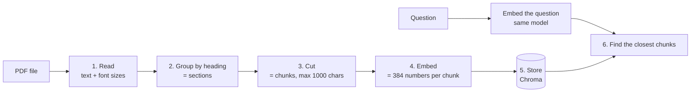

Steps 1 to 5 run when a PDF is uploaded. Step 6 runs for `POST /retrieve` and again inside `POST /answer`. The browser chat calls `/answer` (see [§13.5](#135-frontend-asks-through-post-answer)).

### Who calls whom during an upload

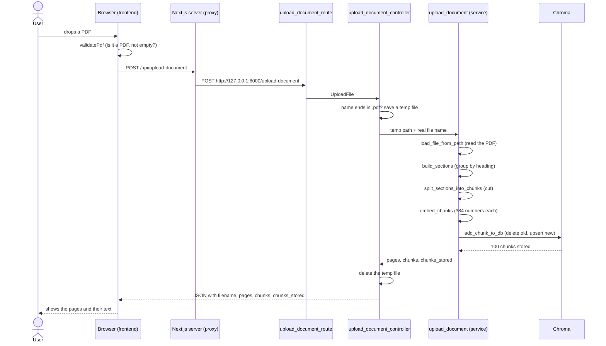

**In one sentence:** the PDF is read page by page, its text is grouped by heading into sections, sections are cut into small chunks, each chunk is turned into a vector that captures its meaning, and the vectors are stored in a vector database so questions can later find the right chunks by meaning.

---

## 2. The running example

All examples below use this small two-page piece of the employee handbook:

```
Page 1:  Leave Policy                                      (16pt font → heading)
         Employees get 20 days of paid leave               (11pt font → body, line 1 of a paragraph)
         per year.                                         (11pt font → body, line 2 of the same paragraph)
         Leave must be applied 2 weeks in advance.         (11pt font → body, a new paragraph)
Page 2:  Unused leave can be carried forward.              (11pt font → body, no new heading)
```

---

## 3. Stage 1: the browser sends the file

> **In plain words:** the browser checks the file is a PDF, then sends it to the server while showing a progress bar.

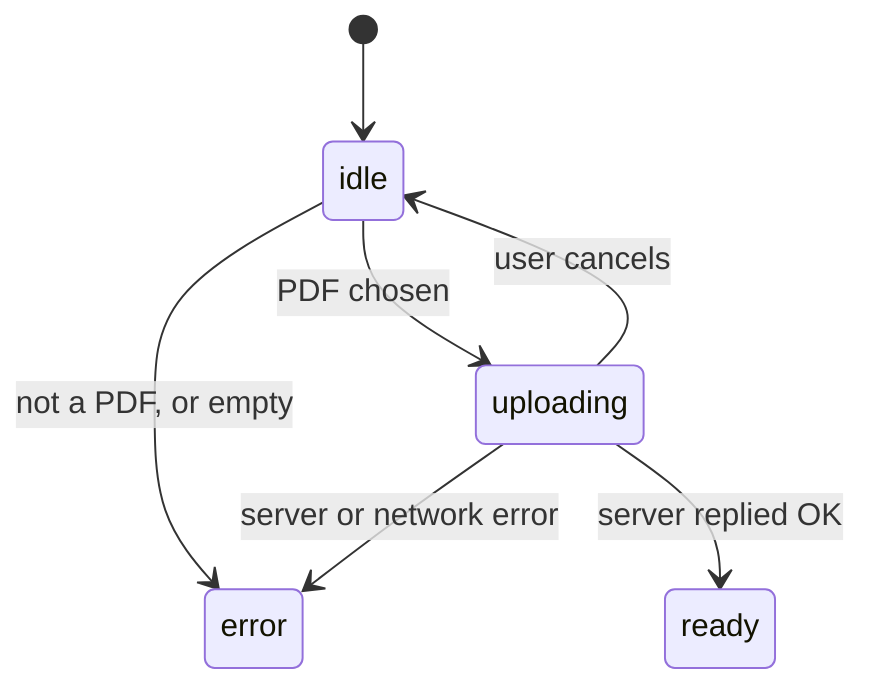

**Folder:** `frontend/`

| Step | File → function | What it does |
|---|---|---|
| 1 | `components/upload-dropzone.tsx` → `UploadDropzone` (L8) | The drop area and file picker. Only offers PDFs (`accept="application/pdf,.pdf"`). Passes the chosen file on. |
| 2 | `hooks/use-document-upload.ts` → `useDocumentUpload` (L14) | Manages the upload state: `idle` → `uploading` (with progress) → `ready` or `error`. |
| 3 | `lib/files.ts` → `validatePdf` (L2) | Checks the file is a PDF (type `application/pdf` or name ending in `.pdf`) and not empty. Stops early with a clear message if not. |
| 4 | `lib/api.ts` → `uploadDocument` (L35) | Sends the file to the server. |

**How the file is sent (`uploadDocument`):**

- The file is put in a `FormData` object under the field name **`file`** (L75). This is a *multipart* upload, the standard way browsers send files.
- It uses `XMLHttpRequest` (L45), not `fetch`, because `XMLHttpRequest` reports **upload progress** (`xhr.upload.onprogress`, L49). That is what drives the progress bar.
- It posts to **`/api/upload-document`** (L46, `API_PREFIX = "/api"`).

**How `/api/...` reaches the backend:** `frontend/next.config.ts` (L21–22) has a *rewrite*: every request to `/api/:path*` is forwarded to `http://127.0.0.1:8000/:path*` (or `API_BASE_URL` if set). So the browser only talks to the frontend server, which passes the request on to FastAPI. This avoids cross-origin (CORS) problems.

---

## 4. Stage 2: the API receives the file

> **In plain words:** the server takes the file, saves it to a temporary file on disk (the PDF reader needs a real file), runs the pipeline on it, sends back the result, and always deletes the temporary file at the end.

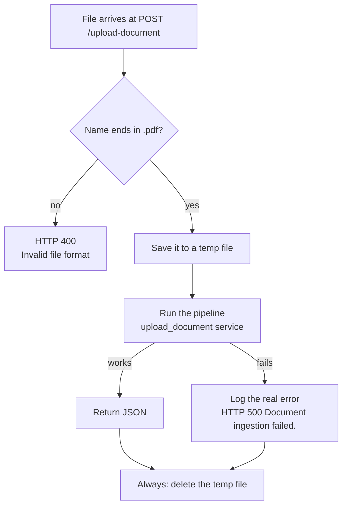

Three layers, one job each:

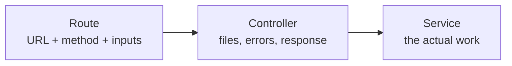

**Folder:** `backend/src/rag_assistant/`

### 4.1 Where the route is registered

| File | What it does |
|---|---|
| `main.py` | Creates the FastAPI `app` and includes one router: `api_router`. |
| `routes/router.py` | `api_router` collects every route module (`health`, `upload_document_route`). New routes are added here. |
| `routes/upload_document_route.py` → `upload_document_route` (L7–8) | `@router.post("/upload-document")`. Receives the file as `UploadFile` and hands it to the controller. |

**Why route → controller → service?** Each layer has one job. The **route** defines the HTTP shape (URL, method, inputs). The **controller** deals with the request: files, errors, the response. The **service** holds the actual work. Each can change or be tested without touching the others.

**Why `UploadFile`?** It streams the upload instead of loading the whole file into memory at once. `File(...)` (the three dots) makes the file **required**.

### 4.2 The controller: `controller/upload_document_controller.py` → `upload_document_controller` (L12)

In order:

1. **Check the name ends in `.pdf`.** If not, it raises `HTTPException(400, "Invalid file format...")` immediately. 400 means "your request was wrong".
2. **Save the upload to a temporary file.** `tempfile.NamedTemporaryFile(delete=False, suffix=".pdf")` creates a real file on disk; `shutil.copyfileobj` copies the upload into it.
   - **Why:** PyMuPDF opens PDFs by **file path**, and the upload is only a stream.
   - **Why `delete=False`:** the file must still exist after the `with` block closes it, while the loader reads it.
3. **Run the pipeline:** `upload_document(temp_path, Path(file.filename).name)`.
   - **Why pass the real file name:** the temporary file has a random name (e.g. `/tmp/tmpk3j9x.pdf`). The real name (`employee_handbook.pdf`) is used as the document's ID in the vector database, so uploading the same file again **replaces** it instead of adding a copy.
   - **Why `Path(...).name`:** keeps only the file name and removes any folder path a client might send (e.g. `../../secret.pdf`).
4. **Return the response:** `{"filename", "pages", "chunks", "chunks_stored"}`.
5. **Errors:** an `HTTPException` is passed on unchanged; any other error is logged with `logger.exception` and turned into `HTTPException(500, "Document ingestion failed.")`. 500 means "the server failed"; details stay in the server log, not in the response.
6. **Always clean up (`finally`):** the temporary file is deleted and the upload is closed, even if something failed.

---

## 5. Stage 3: the service runs the pipeline

**File:** `services/upload_document_service.py` → `upload_document(file_path, file_name)` (L6)

> **In plain words:** an assembly line. One function calls each step in order and hands each step's output to the next step.

This function is the **conductor**: it calls each stage in order and passes the output of one into the next.

```python
pages = load_file_from_path(file_path)                    # Stage 4: read the PDF
sections = build_sections(pages)                          # Stage 5: group by heading
chunks = split_sections_into_chunks(sections)             # Stage 6: cut into chunks (1000 / 200)
embedded_chunks = embed_chunks(chunks)                    # Stage 7: chunk → vector
chunks_stored = add_chunk_to_db(file_name, embedded_chunks)  # Stage 8: save in Chroma
return {"pages": pages, "chunks": chunks, "chunks_stored": chunks_stored}
```

**Why return `chunks` and not `embedded_chunks`:** the vectors are 384 numbers per chunk; for 100 chunks that would make the response very large, and the frontend does not need them.

---

## 6. Stage 4: reading the PDF (pages and spans)

> **In plain words:** first prove the file is really a PDF (every PDF starts with the 5 characters `%PDF-`). Then read every page, and for every piece of text write down three things: the text, its **font size** (big = probably a title), and **which paragraph** it belongs to.

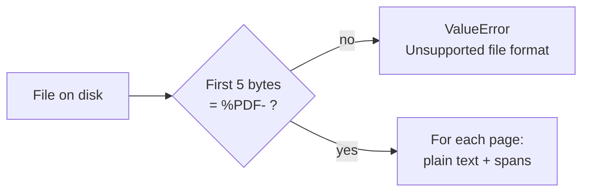

How PyMuPDF sees page 1 of the running example (a page holds blocks, a block holds lines, a line holds spans; here every line is a single span):

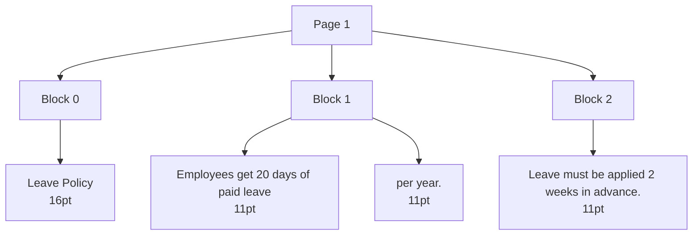

### 6.1 Is it really a PDF? `ingestion/file_loader.py` → `load_file_from_path` (L5)

1. If the path is not a file → `FileNotFoundError`.
2. Reads the **first 5 bytes** of the file. Every real PDF starts with `%PDF-`.
3. If they are `%PDF-` → calls `load_data_from_pdf`. Otherwise → `ValueError("Unsupported file format: ...")`.

**Why check bytes and not just the extension:** anyone can rename `notes.txt` to `notes.pdf`. The first bytes prove what the file really is. (Empty files and text files are rejected here, as `tests/test_loader.py` checks.)

### 6.2 Read every page: `ingestion/pdf_loader.py` → `load_data_from_pdf` (L63)

1. If the file does not exist → `FileNotFoundError`.
2. Opens it with **PyMuPDF** (`pymupdf.open`). If PyMuPDF says it is not a PDF (`document.is_pdf` is false) → `ValueError("The file is not a valid PDF format file")`.
3. For each page (numbered from **1**, not 0):
   - `page.get_text()` → the page's plain text (used by the frontend's text view);
   - `extract_pdf_spans(page, page_number)` → the page's **spans** (below).
4. Returns a list of pages:

```python
{"page_number": 1, "text": "Leave Policy\nEmployees get 20 days...", "spans": [...]}
```

### 6.3 Break each page into spans: `ingestion/pdf_loader.py` → `extract_pdf_spans` (L7)

**What PyMuPDF gives:** `page.get_text("dict")` returns the page as a tree:

```
page
└── blocks       (roughly one paragraph each)
    └── lines    (one visual line of text)
        └── spans    (a run of text in ONE font, size, and style)
```

A new span starts whenever the font, size, or style changes, so a bold word in the middle of a line becomes its own span.

**What the function does:** walks blocks → lines → spans, and for each span:

- strips spaces; **skips spans that are only spaces**;
- keeps: `text`, `size` (font size), `page_number`, **`block_number`** (which paragraph on the page, counted with `enumerate` from 0 on every page), `font`, `flags` (bold/italic bits).

```python
{"text": "Leave Policy", "size": 16.0, "page_number": 1, "block_number": 0, "font": "...", "flags": 16}
```

**Why spans and not just page text:** plain text loses the font size, and font size is how headings are found. **Why `block_number`:** it tells which paragraph a span belongs to, so paragraph breaks can be kept (Stage 5).

**Running example, after Stage 4 (spans):**

| text | size | page | block |
|---|---|---|---|
| Leave Policy | 16 | 1 | 0 |
| Employees get 20 days of paid leave | 11 | 1 | 1 |
| per year. | 11 | 1 | 1 |
| Leave must be applied 2 weeks in advance. | 11 | 1 | 2 |
| Unused leave can be carried forward. | 11 | 2 | 0 |

---

## 7. Stage 5: grouping text into sections

> **In plain words:** read the text from top to bottom. **Big text starts a new topic** (a section). Normal text is added to the current topic: with a **space** if it is the same paragraph, or a **blank line** if it is a new paragraph or a new page.

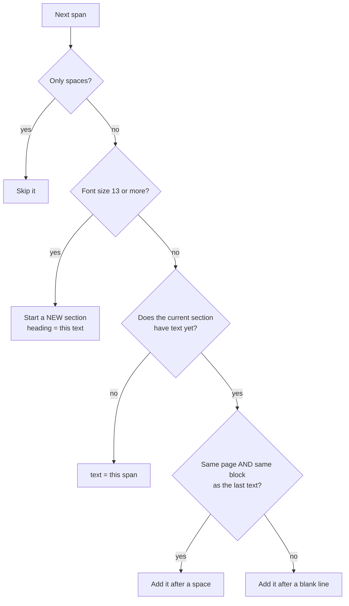

If body text appears before any heading, a section with `heading: None` is created first, so the text is not lost.

The running example, before and after:

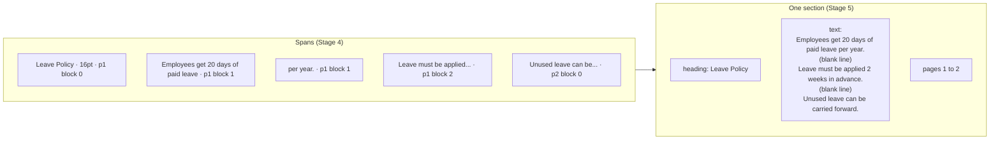

**Method: structure-aware chunking.** The document's own structure (its headings) decides where topics start and end.

### 7.1 Is this span a heading? `ingestion/chunking.py` → `is_heading` (L13)

Returns `True` when `span["size"] >= 13.0`.

- **Why 13:** analysing the real handbook's font sizes showed body text at 12pt and headings at 14pt and above.
- **Limitation:** large body text (a big note) would be treated as a heading.

### 7.2 Build the sections: `ingestion/chunking.py` → `build_sections` (L25)

Goes through every span of every page, in order, keeping a **current section**:

| Situation | What happens |
|---|---|
| Span is empty after stripping | Skipped |
| Span is a **heading** | A new section starts: `heading` = the span's text, `text` = `""`, `page_number` and `end_page` = this page |
| **Body** text before any heading | A section with `heading: None` is created, so intro text is not lost |
| **Body** text, first text after a heading | Becomes the section's text (no leading space) |
| **Body** text, section already has text | Added with a separator, see below |
| Body text added on a later page | `end_page` is updated to that page |

**Choosing the separator (paragraph breaks):** the code remembers where the last body text came from as a pair `previous_position = (page_number, block_number)`.

| Compared with the last body text | Separator | Why |
|---|---|---|
| Same page **and** same block | `" "` (space) | Same paragraph: a wrapped line or a font change |
| Different block, or different page | `"\n\n"` (blank line) | A real paragraph break, kept so the splitter can cut there first |

**Why blocks and not lines:** a PDF "line" is only where text wrapped on the page, often mid-sentence. Keeping line breaks would make the splitter cut sentences in half.

**Running example, after Stage 5 (one section):**

```python
{
  "heading": "Leave Policy",
  "text": "Employees get 20 days of paid leave per year.\n\nLeave must be applied 2 weeks in advance.\n\nUnused leave can be carried forward.",
  "page_number": 1,
  "end_page": 2,
}
```

- "per year." joined with a **space** (same block 1).
- "Leave must…" after a **blank line** (new block 2).
- "Unused leave…" after a **blank line** (new page) and still in the same section, because page 2 has **no new heading**.
- The heading is **not** inside `text`; it is a separate field (metadata).

---

## 8. Stage 6: splitting sections into chunks

**File:** `ingestion/chunking.py` → `split_sections_into_chunks(sections, max_chunk_size=1000, chunk_overlap=200)` (L58)

> **In plain words:** a section can be too long for the model to read, so cut it into pieces of **at most 1000 characters**. Cut at the nicest place available: between paragraphs first, then lines, then sentences, then words. The end of each piece is **repeated** (up to 200 characters) at the start of the next one, so a fact near a cut still has its context. Every piece keeps its section's heading and pages.

Where the cut goes (simplified; the splitter tries each separator in this order):

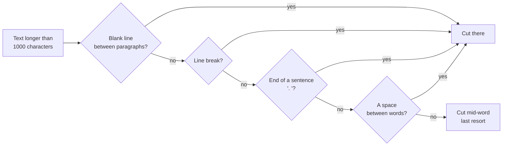

What overlap looks like:

```
Section text:  AAAAAAAAAAAAAAAAAAAAAAAAAAAAAA BBBBBBBB CCCCCCCCCCCCCCCCCCCCCCCCC

Chunk 1:       AAAAAAAAAAAAAAAAAAAAAAAAAAAAAA BBBBBBBB
Chunk 2:                                      BBBBBBBB CCCCCCCCCCCCCCCCCCCCCCCCC
                                              └──────┘
                                              repeated (up to 200 characters)
```

A long section becomes several chunks that all carry the same labels (illustration):

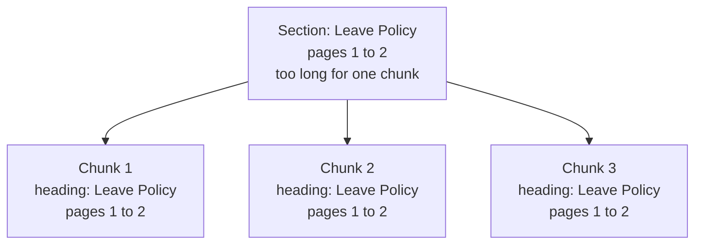

**Why split at all:** a section can be long. The embedding model reads at most 256 tokens, and small focused pieces match questions more precisely than a whole long section.

**Method: recursive character splitting** with LangChain's `RecursiveCharacterTextSplitter` (package `langchain-text-splitters`). Together with Stage 5 this is **hierarchical chunking**: structure first (sections), size second (chunks).

**Step by step:**

1. **Validate settings** (once): `max_chunk_size > 0`, `chunk_overlap >= 0`, `chunk_overlap < max_chunk_size`, otherwise `ValueError`. Overlap must be smaller than the chunk size, or the splitter could never move forward.
2. **Create the splitter:**

| Setting | Value | Why |
|---|---|---|
| `chunk_size` | 1000 characters | A **maximum**, not an exact size |
| `chunk_overlap` | 200 characters | The end of one chunk is repeated at the start of the next, so a fact near a cut keeps its context |
| `separators` | `["\n\n", "\n", ". ", " ", ""]` | Try to cut at a paragraph first, then a line, then a sentence, then a word, and only as a last resort mid-word |
| `keep_separator` | `"end"` | The `.` stays at the end of its sentence instead of starting the next chunk |

3. **For each section:** skip it if its text is empty or only spaces (heading-only sections); otherwise cut its text and make one chunk per piece with `{**section, "text": piece}`, a **new** dictionary that copies the section's `heading`, `page_number`, `end_page` and replaces `text` with the piece.

**Why it is not "fixed-size chunking":** fixed-size cuts exactly every N characters, wherever that lands (often mid-word). Recursive splitting treats N as a maximum and cuts at the best boundary before it, so chunk sizes vary (e.g. 99, 99, 81, 83, 83 in a test).

**Running example, after Stage 6:** the section is about 125 characters, under 1000, so it stays **one chunk** with the same fields. A long section would become several chunks, **all** carrying heading "Leave Policy" and pages 1–2.

---

## 9. Stage 7: turning chunks into vectors (embeddings)

**File:** `ingestion/embeddings.py`

> **In plain words:** the model reads a chunk and writes down **384 numbers** that describe what it means. Think of them as GPS coordinates on a "map of meaning": chunks that mean similar things land close together, even if they use different words. A question gets coordinates too, and the closest chunks are the answers.

The map of meaning (really 384 directions; drawn here with 2):

```
                 ● Leave Policy chunk
                    ↖ close: score 0.682
                      ● "How many leave days do I get?"


                                              ● Office Hours chunk
                                                 far: score 0.234
```

What happens inside, for one chunk:

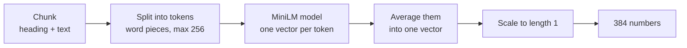

**How two vectors are compared:** picture each vector as an arrow. Arrows pointing the same way mean the same thing (score 1); arrows at right angles are unrelated (score 0). Because every arrow is scaled to the same length, the score is just "multiply the numbers in pairs and add them up" (the dot product).

```
  score = a1×b1 + a2×b2 + ... + a384×b384      (= cosine similarity, because both vectors have length 1)
```

**What an embedding is:** a list of numbers that describes a text's **meaning**. Texts with similar meaning get similar numbers, even if they share no words. This is what makes searching by meaning possible.

**Model:** `all-MiniLM-L6-v2` from the `sentence-transformers` library. It runs locally (no API key), returns **384 numbers** per text, and reads at most **256 tokens** per text.

### 9.1 Load the model once: `get_embedding_model` (L8)

`@lru_cache(maxsize=1)` remembers the loaded model. The first call loads it (a few seconds: about 90 MB of weights from `~/.cache/huggingface`); every later call returns the same model instantly.

The model name is one constant, `EMBEDDING_MODEL`, used for both chunks and questions. **Vectors from different models cannot be compared**; changing the model means re-embedding every stored chunk.

### 9.2 What text is embedded: `text_for_embedding` (L14)

```
heading + "\n" + text      e.g. "Leave Policy\nEmployees get 20 days..."
text only                  when the chunk has no heading
```

**Why add the heading (a "contextual chunk header"):** a chunk like "Must be applied 2 weeks in advance." does not say it is about leave. Adding the heading puts the topic into the vector. The chunk's stored `text` stays clean; only the model's input includes the heading.

### 9.3 Embed all chunks: `embed_chunks` (L20)

1. Empty list → returns `[]` (the model is not even loaded).
2. **Loop 1:** builds the list of texts with `text_for_embedding`.
3. **One call:** `model.encode(texts, normalize_embeddings=True)`.
   - Inside `encode`: text → **tokens** (word pieces) → cut at 256 tokens → the model makes a vector per token → averaged into **one 384-number vector per text**.
   - **Batching:** all texts in one call is much faster than one call per text (overhead paid once, maths done in parallel).
   - **Normalising:** every vector is scaled to length 1, so comparing two vectors with a plain **dot product** gives the **cosine similarity** (how close their meanings are).
4. **Loop 2:** pairs each chunk with its vector (`zip`, same order) and returns the chunk plus an `"embedding"` field. `.tolist()` turns NumPy numbers into a plain list, which Chroma and JSON need.

### 9.4 Embed a question: `embed_user_query` (L46)

Same model, same normalisation, one text in → **one bare vector** out (a list of 384 numbers, not a dictionary). Used by search.

---

## 10. Stage 8: storing vectors in Chroma

**File:** `storage/vector_store.py`

> **In plain words:** Chroma is a filing cabinet for vectors. Every chunk becomes one card with four things on it: an **ID**, the **vector**, the **text**, and some **labels** (file name, heading, pages). Before filing a document, its old cards are thrown away, so uploading the same file twice replaces it instead of making copies.

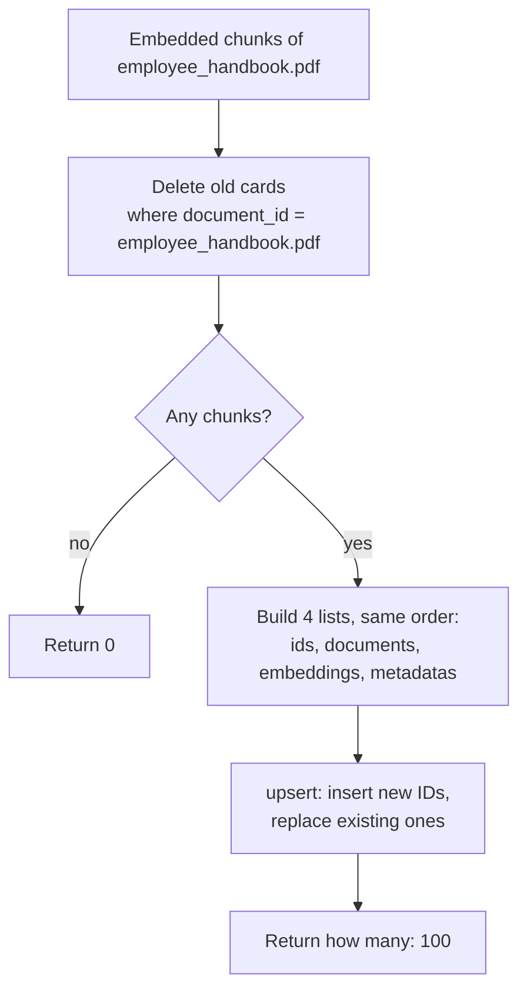

One card (record) in Chroma:

```
┌─────────────────────────────────────────────────────────────────┐
│ id         employee_handbook.pdf--0                             │
│ embedding  [0.02, -0.10, ...]            384 numbers            │
│ document   Employees get 20 days of paid leave per year. ...    │
│ metadata   document_id = employee_handbook.pdf                  │
│            heading     = Leave Policy                           │
│            page_number = 1,  end_page = 2                       │
│            embedding_model = all-MiniLM-L6-v2                   │
└─────────────────────────────────────────────────────────────────┘
```

**What a vector database is:** a database that stores vectors with their text and metadata, and quickly finds the vectors **closest** to a question's vector. Chroma uses an **HNSW** index (an approximate nearest neighbour method) so it does not have to compare the question with every stored vector.

**Why Chroma:** it runs inside the Python app, saves to a local folder, needs no account or API key, and keeps documents on the machine. This file is the **only** place that talks to Chroma, so switching databases later means changing one file.

### 10.1 Open the collection once: `get_collection` (L11)

- `chromadb.PersistentClient(path=...)` saves to **`backend/data/chroma/`** (ignored by git), so data survives server restarts.
- `get_or_create_collection(name="dataStorage_collection", configuration={"hnsw": {"space": "cosine"}})`: created the first time, reused after. **`space: cosine`** is the distance metric and can only be set at creation.
- `@lru_cache` opens it once per server run.

### 10.2 Save one document: `add_chunk_to_db(document_id, chunks)` (L22)

1. **Delete the old version first:** `collection.delete(where={"document_id": document_id})`. If a new version has fewer chunks, the old extra chunks would otherwise stay and keep appearing in searches.
2. Empty list → returns `0`.
3. **Builds four lists**, one entry per chunk, same order:

| List | Example | From |
|---|---|---|
| `ids` | `"employee_handbook.pdf--0"` | document ID + position. The same file always gives the same IDs |
| `documents` | `"Employees get 20 days..."` | `chunk["text"]` (clean, no heading) |
| `embeddings` | `[0.02, -0.10, ...]` (384 numbers) | `chunk["embedding"]`: **our** vector; Chroma never embeds anything itself |
| `metadatas` | `{"document_id", "heading", "page_number", "end_page", "embedding_model"}` | the chunk's fields. `heading` uses `""` instead of `None` because Chroma silently drops `None` values |

4. **`collection.upsert(...)`** in one call: inserts new IDs and **replaces** existing ones (`add` would ignore existing IDs).
5. Returns how many chunks were stored (100 for the handbook).

---

## 11. Stage 9: the response goes back to the browser

> **In plain words:** the server replies with the file name, the pages, the chunks, and how many chunks were stored. The vectors are **not** sent back: they are large and the browser does not need them.

The controller returns:

```json
{
  "filename": "employee_handbook.pdf",
  "pages":  [ {"page_number": 1, "text": "...", "spans": [...]}, ... ],
  "chunks": [ {"heading": "Leave Policy", "text": "...", "page_number": 1, "end_page": 2}, ... ],
  "chunks_stored": 100
}
```

On the frontend, `lib/api.ts` → `isUploadResponse` (L133) checks the response has `filename` and a valid `pages` list, and the app shows the pages (original PDF view and extracted text). The extra fields (`chunks`, `chunks_stored`) are ignored by the frontend for now, so adding them did not break anything.

---

## 12. Stage 10: retrieving with `POST /retrieve`

> **In plain words:** the question arrives as JSON and is checked (bad input gets 422). Dense search and BM25 run once, ranks fuse with RRF, and a gate decides whether to return or rewrite once. Before return, a cross-encoder reorders the fused top-k (dense `.score` unchanged). Junk queries stay empty. (Path was `/search`; renamed to `/retrieve` for outcome clarity.)

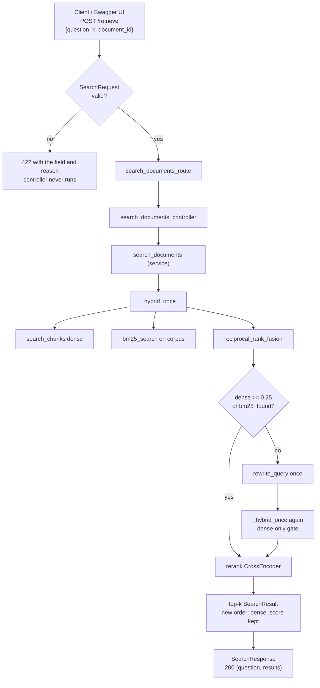

### 12.1 The API layers

| Layer | File → function | Job |
|---|---|---|
| Models | `schemas/search_schema.py` → `SearchRequest`, `SearchResultItem`, `SearchResponse` | `question` at least 1 character; `k` default 5, between 1 and 20 (`"5"` is converted, `"five"` or `0` → 422); `document_id` optional |
| Route | `routes/search_documents_route.py` → `search_documents_route` | `POST /retrieve` with `response_model=SearchResponse`; plain `def`, so FastAPI runs it in a worker thread while the question is embedded |
| Controller | `controller/search_documents_controller.py` → `search_documents_controller` (L9) | Calls the service, turns each result into `SearchResultItem(**result)`; unexpected errors are logged and return a generic 500 "Search failed." |
| Service | `services/search_documents_service.py` → `search_documents` / `_hybrid_once` | Dense + BM25 → RRF; return if dense ≥ 0.25 or `bm25_found`; else rewrite once then hybrid again (post-rewrite ignores `bm25_found`); then `rerank` on success paths |
| Storage | `storage/vector_store.py` → `search_chunks` | Embeds the question and asks Chroma for the `k` closest chunks; each result includes `chunk_id` |
| Sparse / fuse | `services/retrieval/bm25.py`, `rrf.py` | Keyword ranks + RRF; used inside `_hybrid_once` on every `/retrieve` |
| Rerank | `services/retrieval/rerank.py` → `rerank` / `cross_encoder_score` | After gate; reorder only; default `ms-marco-MiniLM-L6-v2`; keep dense `.score` |

The route is registered in `routes/router.py`, next to upload.

### 12.2 Inside `search_chunks(question, k=5, document_id=None)`

1. `k` must be at least 1, otherwise `ValueError`.
2. Empty collection → returns `[]` (no model load).
3. `embed_user_query(question)` → the question's vector (same model and settings as the chunks).
4. Optional filter: `where={"document_id": ...}` to search one document only; `None` searches everything.
5. `collection.query(query_embeddings=[vector], n_results=k, where=...)`.
   - Results come back as **lists inside lists** (one inner list per question). We send one question, so we read `[0]`. Results are already sorted, closest first.
   - Chroma returns a **distance**; smaller is closer. **similarity = 1 − distance**.
6. Returns a list of `SearchResult`: `text`, `heading`, `page_number`, `end_page`, `document_id`, `score`, `chunk_id` (Chroma id).

**Example (hybrid + rerank):** "How many leaves can I take?" → fused list with **PTO in top 5**; cross-encoder may move ranks (eval often **PTO@2**). France / cake → `[]` after the post-rewrite dense-only gate. Eval after rerank: hit@5 **8/8**, MRR **0.73** (hybrid-only was 0.69).

**Important:** `query` always returns up to `k` chunks, **even unrelated ones**. That is why the service applies a minimum score.

### 12.3 Why `k = 5` and `MIN_SCORE = 0.25`

Measured on 2026-11-10 with 8 handbook questions (each with a known correct section) and 3 unrelated questions:

| Measure | Value |
|---|---|
| Correct section at rank 1 / in top 3 / in top 5 | 6 of 8 / 7 of 8 / **8 of 8** |
| MRR | 0.84 |
| Lowest score of a correct answer | 0.385 ("Am I paid extra for working late?" → Overtime, rank 2) |
| Highest score of an unrelated question | 0.091 ("How do I bake a chocolate cake?") |

- **k = 5:** the smallest k that finds the correct section for all 8 questions. "How many days of annual leave do I get?" puts Paid time off (PTO) at rank 4, so `k = 3` would miss it.
- **MIN_SCORE = 0.25:** sits between 0.091 and 0.385 with margin on both sides. 0.3 dropped relevant chunks ("Employee relationships", 0.285, for "Can I date a coworker?"). The cost is some weak noise between 0.25 and 0.3.
- Failure patterns seen: different words for the same idea ("annual leave" vs "Paid Time Off"), one section split into several chunks taking several of the 5 places, and short general chunks ("Time", "Tuition or relocation reimbursement") appearing for many questions.

---

## 13. Stage 11: answering with `POST /answer`

> **In plain words:** the question goes through the same search as Stage 10. If search finds nothing, the answer is "not found" and Gemini is never called. Otherwise the found chunks are numbered and sent to Gemini with fixed rules. Gemini fills in a form (`found`, `answer`, `citations`). Code checks the cited numbers, takes the pages from the chunks themselves, and returns the answer with its sources.

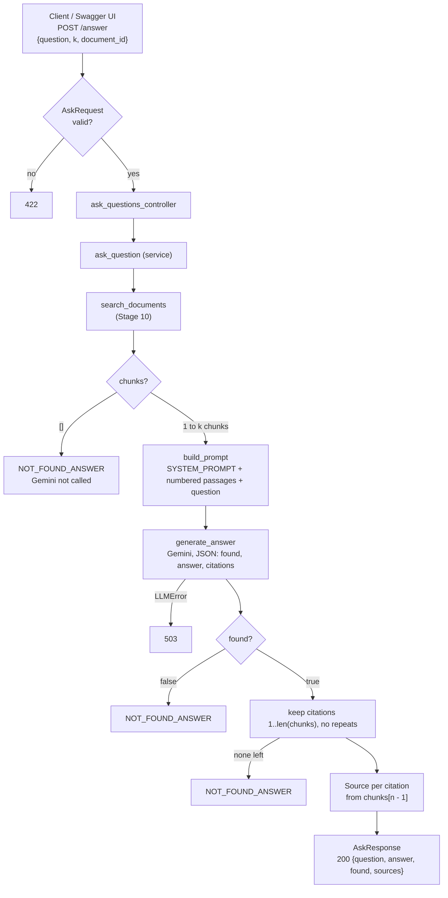

### 13.1 The layers

| Layer | File → function | Job |
|---|---|---|
| Models | `schemas/ask_schema.py` → `AskRequest` (L3), `Source` (L8), `AskResponse` (L14) | Same request rules as `/retrieve`; a `Source` is `heading`, `page_number`, `end_page`, `document_id` (no `text`, no `score`) |
| Route | `routes/ask_questions_route.py` → `ask_questions_route` | `POST /answer`, plain `def` (embedding and the Gemini call run in a worker thread) |
| Controller | `controller/ask_questions_controller.py` → `ask_questions_controller` (L10) | `LLMError` → **503** "The answer service is not available right now. Try again later."; anything else → **500** |
| Service | `services/ask_service.py` → `ask_question` (L9) | Search, "not found" checks, prompt, Gemini, citation check, sources |
| Prompt | `generation/prompt_builder.py` → `build_prompt` (L20) | `(SYSTEM_PROMPT, user_prompt)`; passages labelled `[1] Heading` |
| LLM | `generation/llm_client.py` → `generate_answer` (L40) | One Gemini call; returns `LLMResponse` or raises `LLMError` |

### 13.2 Inside `generate_answer(system_prompt, user_prompt)`

1. `_get_client()` (L30) creates the Gemini client on the **first call only** (`lru_cache`); it reads `GEMINI_API_KEY` from `backend/.env`.
2. Request: model `GEMINI_MODEL` from `.env` (default `gemini-3.5-flash-lite`), `system_instruction` = the rules, `contents` = passages + question, temperature 0.3, at most 500 output tokens, JSON matching `LLMResponse`.
3. Timeout 15 s per try, 2 tries (1 retry) for 408 and 5xx only; 429 is not retried. Worst case about 30 s.
4. Errors: Gemini replied with an error (`errors.APIError`), no reply (`httpx2.RequestError`), or a reply that does not match the schema (`response.parsed` is not an `LLMResponse`) → `LLMError`.

### 13.3 Three ways to "not found"

| Case | Example | Decided by | Gemini called? |
|---|---|---|---|
| Search returns `[]` | "What is the capital of France?" | Search (`MIN_SCORE`) | No |
| Chunks found, but they do not answer | "Can I bring my pet dog to the office?" (5 chunks) | Gemini: `found: false` | Yes |
| `found: true`, but no valid citation | `citations: [9]` with 5 chunks sent | The citation check | Yes |

All three return the same `NOT_FOUND_ANSWER` with `found: false` and `sources: []`.

### 13.4 The citation check

1. Keep a number only if it is between 1 and `len(chunks)` and not already kept (`[1, 1, 7, 2]` with 5 chunks → `[1, 2]`, order kept).
2. Nothing left → "not found": an answer that cannot be traced to a page is not shown.
3. Each kept `n` becomes a `Source` from `chunks[n - 1]` (the prompt counts from 1, the list from 0). Pages always come from the chunk metadata, never from Gemini's text.

**Real result (2026-11-13, Swagger UI):** "What is the notice period for resignation?" → `found: true`, "…at least two weeks' notice…", one source: Resignation, page 32, `employee_handbook.pdf`.

### 13.5 Frontend asks through `POST /answer`

> **In plain words:** after upload, the chat sends the question **and** the uploaded filename. The API answers only from that document's chunks. The UI shows the answer text, citation marks, and a short sources list.

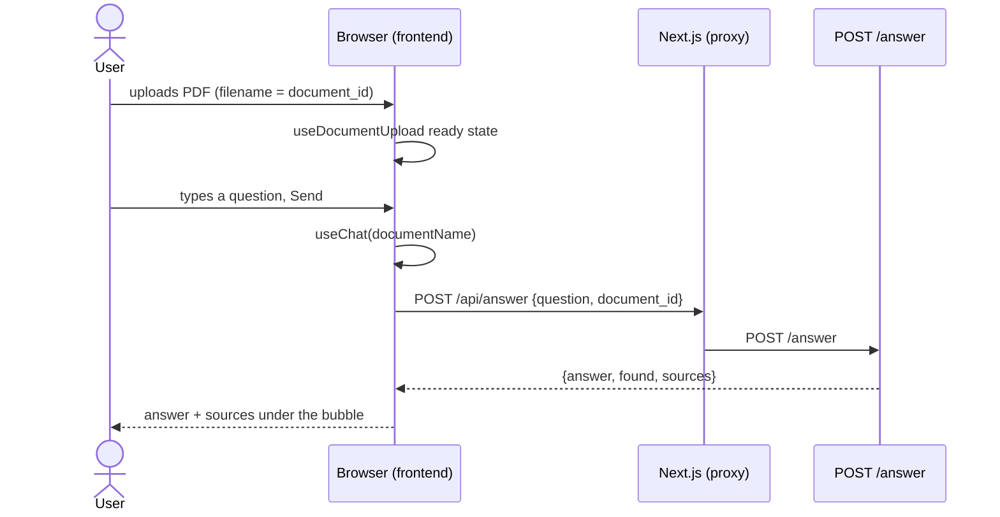

| Step | File → function | What it does |
|---|---|---|
| Keep filename | `hooks/use-document-upload.ts` | Ready state stores `document.filename` from upload |
| Scope chat | `components/workspace.tsx` → `ConnectedChat` | `useChat(documentName)`; `key={documentName}` clears old bubbles |
| Send | `hooks/use-chat.ts` → `send` | `askQuestion({ question, document_id: documentId ?? null })`; stores `sources` on the assistant message |
| HTTP | `lib/api.ts` → `askQuestion` | `POST /api/answer`, validates `AskResponse` |
| Render | `components/chat-message.tsx` | Paragraphs + `[n]` marks; sources list (heading, pages) |

**Why `document_id` matters:** upload stores chunks under `document_id = file_name` (`add_chunk_to_db`). Without that id on `/answer`, search runs over **every** PDF in Chroma, so an older handbook can answer a question about a new file.

**Not in the UI yet:** a separate `/retrieve` debug view (passages only). Chat uses `/answer` only.

---

## 14. Stage 12: streaming answer with `POST /answer/stream`

> **In plain words:** the same search runs as Stage 10. If nothing is found, one `done` event goes back and Gemini is never called. Otherwise Gemini streams plain-text tokens; each token is forwarded to the browser live as an SSE event. After the last token, `[n]` markers in the full answer are parsed to find which chunks were cited. A final `done` event carries the sources. If Gemini fails, an `error` event replaces `done`.

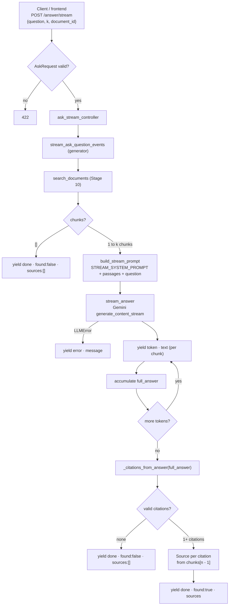

### 14.1 The layers

| Layer | File → function | Job |
|---|---|---|
| Route | `routes/ask_questions_route.py` → `ask_questions_stream_router` | `POST /answer/stream`; wraps the generator in `StreamingResponse(media_type="text/event-stream")` |
| Controller | `controller/ask_questions_controller.py` → `ask_stream_controller` | Returns the generator directly; no try/except — errors are SSE `{"type":"error"}` events inside the generator |
| Generator | `services/ask_service.py` → `stream_ask_question_events` | The full logic: search → prompt → stream tokens → parse citations → yield events |
| Prompt | `generation/prompt_builder.py` → `build_stream_prompt` | Returns `(STREAM_SYSTEM_PROMPT, user_prompt)`; same passage format as `build_prompt`, no JSON schema |
| LLM | `generation/llm_client.py` → `stream_answer` | Calls `generate_content_stream`, yields each text piece; no `response_schema` |
| Citation parse | `services/ask_service.py` → `_citations_from_answer` | Reads `[n]` from the accumulated plain-text answer; deduplicates; drops out-of-range numbers |

### 14.2 SSE event shapes

Every line the generator yields is one SSE event: `data: {...}\n\n`.

| Event | Shape | When |
|---|---|---|
| token | `{"type":"token","text":"..."}` | Once per Gemini text chunk |
| done (found) | `{"type":"done","found":true,"sources":[...]}` | After the last token, citations valid |
| done (not found) | `{"type":"done","found":false,"sources":[]}` | Search `[]`, or no valid `[n]` after streaming |
| error | `{"type":"error","message":"..."}` | `LLMError` or unhandled exception inside the generator |

### 14.3 Why not reuse the JSON `/answer` path

The JSON path (`generate_answer`) uses `response_schema` which forces Gemini to return a structured object; the entire JSON object must be complete before it can be parsed. That means tokens cannot be forwarded until the whole reply arrives — no streaming is possible.

The stream path (`stream_answer`) calls `generate_content_stream` with no schema: Gemini emits free-text chunks immediately. The trade-off is that `citations` must be parsed from `[n]` markers in the text instead of read from a field.

### 14.4 Why `_citations_from_answer` runs after all tokens

The model can write `[1]` anywhere in the answer, including at the very end. There is no safe point to parse citations mid-stream. The generator accumulates every token in `full_answer` and calls `_citations_from_answer` once, after the stream ends.

### 14.5 Frontend: Next.js Route Handler

The Next.js rewrite in `next.config.ts` collects the full response before forwarding. For SSE this means the browser receives nothing until the stream ends — defeating the purpose.

`frontend/app/api/answer/stream/route.ts` is a Route Handler that bypasses the rewrite. It fetches the FastAPI backend directly and returns `response.body` (a `ReadableStream`) piped through without buffering. The browser receives each SSE event as it arrives.

`frontend/lib/api.ts` → `streamAskQuestion` reads the stream, splits on `\n\n` (SSE event separator), and dispatches `onToken` / `onDone` / `onError` callbacks. `frontend/hooks/use-chat.ts` calls `flushSync` on each `onToken` to force React to re-render immediately per token.

---

## 15. The data at every stage

> **In plain words:** the same text changes shape as it moves along: pages, then sections, then chunks, then chunks with vectors, then records in Chroma.

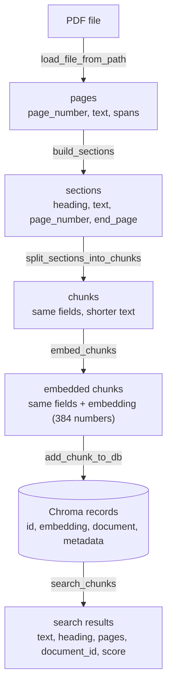

| After stage | Shape | Example |
|---|---|---|
| 4: pages | `list` of `{page_number, text, spans}` | `{"page_number": 1, "text": "...", "spans": [...]}` |
| 4: span | `{text, size, page_number, block_number, font, flags}` | `{"text": "Leave Policy", "size": 16.0, "page_number": 1, "block_number": 0, ...}` |
| 5: section (`DocumentSection`) | `{heading, text, page_number, end_page}` | `{"heading": "Leave Policy", "text": "...\n\n...", "page_number": 1, "end_page": 2}` |
| 6: chunk | same shape as a section, smaller `text` | `{"heading": "Leave Policy", "text": "Employees get...", "page_number": 1, "end_page": 2}` |
| 7: embedded chunk (`EmbeddedChunk`) | chunk + `embedding` | `{..., "embedding": [0.02, -0.10, ... 384 numbers]}` |
| 8: Chroma record | `id`, `embedding`, `document`, `metadata` | `"employee_handbook.pdf--0"`, vector, text, `{"document_id", "heading", "page_number", "end_page", "embedding_model"}` |
| 10: search result (`SearchResult`) | `{text, heading, page_number, end_page, document_id, score}` | `{"heading": "Leave Policy", "score": 0.682, ...}` |
| 11: Gemini reply (`LLMResponse`) | `{found, answer, citations}` | `{"found": true, "answer": "...two weeks' notice...", "citations": [1]}` |
| 11: answer (`AskResponse`) | `{question, answer, found, sources}` | `{"found": true, "sources": [{"heading": "Resignation", "page_number": 32, "end_page": 32, "document_id": "employee_handbook.pdf"}]}` |

---

## 16. Real numbers from the handbook

| Measure | Value |
|---|---|
| Chunks produced | 100 |
| Chunks stored in Chroma (upload, and upload again) | 100 and 100 (replaced, not duplicated) |
| Largest chunk, heading included | 235 tokens (limit 256, so nothing is cut off) |
| Average chunk | 128 tokens |
| Characters per token | about 5 (plain English; text full of codes or numbers can be about 2) |
| Vector size | 384 numbers |
| Chunk settings | 1000 characters, 200 overlap |

---

## 17. When something breaks: where to look

| Symptom | Likely stage | Where to look |
|---|---|---|
| Browser says "not a PDF" or "empty" before uploading | 1 | `frontend/lib/files.ts` → `validatePdf` |
| Upload never reaches the server | 1 | `frontend/next.config.ts` rewrite; is the backend running on port 8000? |
| HTTP 400 "Invalid file format" | 2 | Controller: file name does not end in `.pdf` |
| HTTP 500 "Document ingestion failed." | 3–8 | Backend terminal log (`logger.exception` prints the real error) |
| Headings missing or wrong | 5 | `is_heading` threshold (13pt) vs the PDF's real font sizes |
| Paragraphs run together, or breaks in odd places | 4–5 | `block_number` in `extract_pdf_spans`; separator logic in `build_sections` |
| Chunks too big or cut badly | 6 | `split_sections_into_chunks` settings |
| First upload very slow | 7 | Normal: the model loads on first use |
| `403` / network error loading the model | 7 | Model download check; set `HF_HUB_OFFLINE=1` to use the local copy |
| Duplicate or outdated chunks in search | 8 | `add_chunk_to_db`: delete-then-upsert and the `document_id` |
| Search returns unrelated chunks | 10 | Check the `score` values against `MIN_SCORE` in `services/search_documents_service.py` |
| Search returns `[]` for a question the handbook answers | 10 | Scores fell below `MIN_SCORE`; call `search_chunks` directly to see the raw scores |
| HTTP 422 from `/retrieve` | 10 | The response names the field: empty `question`, or `k` not a whole number from 1 to 20 |
| HTTP 500 "Search failed." | 10 | Backend terminal log (`logger.exception` prints the real error) |
| `/answer` always says "not found" from Swagger UI | 11 | The example body sends `"document_id": "string"`; remove the line or set it to `null` |
| HTTP 503 from `/answer` | 11 | Backend log shows the `LLMError` and Gemini's message: 429 (free-tier limit, wait for the reset at 13:30 IST), 404 (model name not available, change `GEMINI_MODEL` in `.env`), or a timeout |
| "No API key was provided" | 11 | `backend/.env` is missing `GEMINI_API_KEY`; `llm_client.py` loads `.env` from its full path, so the working folder does not matter |
| Chat answers from the **old** PDF after a new upload | 11 / 13.5 | UI must send `document_id` = new filename (`workspace` → `useChat`); without it, Chroma searches all docs |
| Chat has no sources under the answer | 13.5 | `use-chat` must store `response.sources`; `chat-message` must render them |

---

## 18. Glossary

| Term | Meaning |
|---|---|
| **Span** | A run of PDF text in one font, size, and style |
| **Block** | PyMuPDF's group of lines, roughly one paragraph |
| **Section** | All body text under one heading (`DocumentSection`) |
| **Chunk** | A piece of a section, small enough to embed |
| **Overlap** | Text repeated at the start of the next chunk to keep context |
| **Token** | A word piece the model reads; about 4–5 characters in English |
| **Embedding / vector** | 384 numbers describing a text's meaning |
| **Normalised** | Scaled to length 1, so dot product = cosine similarity |
| **Cosine similarity** | How close two meanings are: 1 = same, 0 = unrelated |
| **Distance** (Chroma) | 1 − cosine similarity; smaller is closer |
| **Collection** | Chroma's "table" of records |
| **Upsert** | Insert if the ID is new, replace if it exists |
| **Metadata** | Extra fields stored with a vector, used for filtering and citations |
| **ANN / HNSW** | Fast approximate search that avoids comparing with every vector |
| **RAG** | Retrieval-augmented generation: search finds the passages, then an LLM writes the answer from them |
| **Grounded answer** | An answer written only from the supplied passages, not from the model's training memory |
| **Structured output** | The LLM replies in JSON that matches a schema (`LLMResponse`), so code reads fields instead of free text |
| **Citation / source** | A passage number the answer used (`[1]`), shown to the user as heading, pages and document |

---

## 19. Not built yet

- Larger retrieve pool then cut (tried 20/10 → 5 on 2026-11-19; **regressed** vs pool=k; deferred).
- A startup check that `GEMINI_MODEL` exists (a wrong name is found only at the first question).
- A server-side upload size limit; loading the model at server start.
- A file that has a `.pdf` name but is not a real PDF fails with HTTP **500** instead of a clearer **400** (the `ValueError` from `load_file_from_path` is caught by the controller's general error handler).
- Real user-role ACL at retrieve (optional `document_id` filter only).
- Frontend `/retrieve` debug panel (chat already uses `/answer` + sources).
- `git init` (deferred to end; `.gitignore` ready).

- **Streaming visual effect:** backend streams correctly (EventStream confirmed); text appears all at once in the browser. Deferred. Likely fix: disable `cacheComponents` in `next.config.ts` or test in production build.

**Built since earlier drafts of this list:** offline `/ask` tests with mocked Gemini; vector store persistence tests; gated query rewrite + gate tests; BM25 + smoke; RRF helper + unit test; hybrid wired into `search_documents`; cross-encoder rerank after gate (eval hit@5 8/8, MRR 0.73); frontend `POST /answer` with upload `document_id` and sources UI; `POST /answer/stream` SSE twin with generator, controller, route, 3 stream tests, frontend Route Handler and `streamAskQuestion` consumer.
