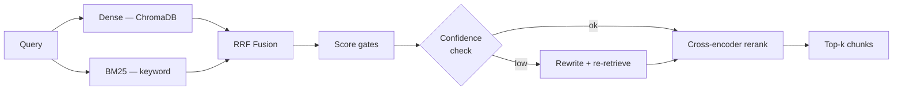
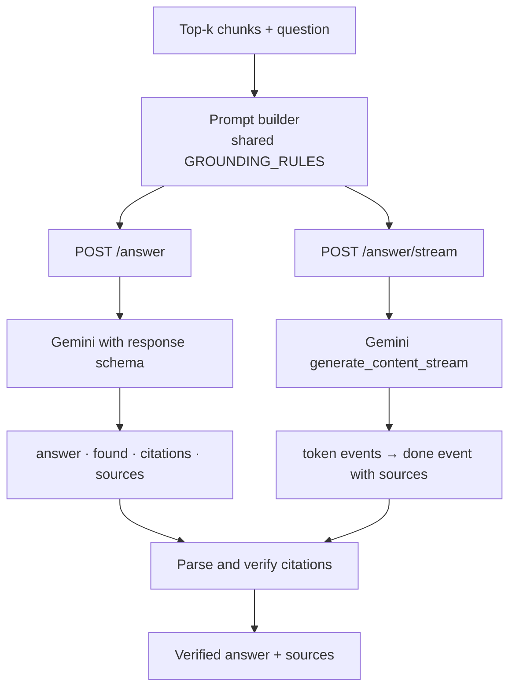

# RAG Document Assistant

A Retrieval-Augmented Generation (RAG) system that answers questions strictly from the content of uploaded documents. Upload a PDF, ask anything — the system retrieves the most relevant passages, grounds the answer in those passages only, and returns cited sources alongside the response.

If the answer is not in the document, the system says so.

---

## Design decisions

These choices shape every part of the system — worth reading before the diagrams.

| Concern | Approach |
|---|---|
| **Retrieval** | Hybrid dense + BM25, fused with Reciprocal Rank Fusion (RRF) |
| **Candidate quality** | Score gates → gated query rewrite → cross-encoder rerank |
| **Hallucination control** | Service short-circuits before the LLM call if retrieval returns nothing |
| **Citations** | Parsed from `[n]` markers, verified against retrieved chunks — not model-reported |
| **Answer delivery** | Structured JSON (`POST /answer`), token-by-token SSE (`POST /answer/stream`), and tool-calling path (`POST /answer/tools`) |
| **Tool calling** | Gemini rewrites the search query via a `FunctionDeclaration` on call 1; grounded answer generated on call 2 |
| **Model fallback** | `_call_with_fallback` wrapper swaps to `FALLBACK_GEMINI_MODEL` on 429 / 404 |
| **Prompt injection** | `GROUNDING_RULES` explicitly marks passages as untrusted data; injection break-attempt test passes |
| **Evaluation** | Offline retrieval eval suite: Hit@5, MRR, latency per query; regression suite (7 live Gemini tests) |
| **Tests** | 91 tests (84 offline + 7 live regression); Gemini and ChromaDB fully mocked in offline suite |

**Dense retrieval** uses sentence-transformer embeddings (MiniLM-L6-v2) stored in ChromaDB.  
**BM25** is a classic keyword-based ranking function that complements dense search on exact or rare terms.  
**RRF (Reciprocal Rank Fusion)** merges the two ranked lists by position, without normalising scores.  
**Cross-encoder rerank** (`ms-marco-MiniLM-L-6-v2`) rescores the fused candidates by reading query and chunk together — more accurate than embedding similarity alone.

---

## End-to-end flow

```mermaid
flowchart TD
    subgraph INGEST["Ingest path"]
        A[PDF Upload] --> B[Parse pages]
        B --> C[Split into sections]
        C --> D[Chunk text]
        D --> E[Embed — MiniLM-L6-v2]
        E --> F[(ChromaDB)]
    end

    subgraph ASK["Ask path"]
        G[Question] --> H1[Dense retrieval]
        G --> H2[BM25 sparse retrieval]
        H1 --> I[RRF Fusion]
        H2 --> I
        I --> J[Score gates]
        J --> K{Score below floor?}
        K -- yes --> L[Rewrite query\nRe-retrieve]
        K -- no --> M[Cross-encoder rerank]
        L --> M
        M --> N{Results found?}
        N -- no --> O[NOT_FOUND — LLM never called]
        N -- yes --> P[Build prompt]
        P --> Q[Gemini]
        Q --> R1[POST /answer\nStructured JSON]
        Q --> R2[POST /answer/stream\nSSE token stream]
        R1 --> S[Parse and verify citations]
        R2 --> S
        S --> T[Grounded answer + sources]
    end
```



---

## Retrieval pipeline



The pipeline runs entirely on local models up to the LLM call. No external embedding or reranking API.

**Offline eval on the development document:** Hit@5 = 8/8 · MRR = 0.73 · median latency ~26 ms

---

## Answer generation



Both endpoints share one grounding ruleset and one user-prompt template — only the system prompt differs. Citations (`[n]`) are parsed from the model's output and cross-referenced against the retrieved chunk list. Any citation that does not map to a retrieved chunk is dropped before the response is returned.

---

## Stack

| Layer | Technology |
|---|---|
| API | FastAPI + Uvicorn |
| Embeddings | `sentence-transformers` MiniLM-L6-v2 (local) |
| Vector store | ChromaDB (persistent, on-disk) |
| Sparse retrieval | BM25 (`rank-bm25`) |
| Reranking | `cross-encoder/ms-marco-MiniLM-L-6-v2` |
| LLM | Google Gemini (`google-generativeai`) |
| Frontend | Next.js 14 — App Router, Route Handlers, `flushSync` for streaming |
| Tests | pytest + unittest.mock |

---

## Project structure

```
backend/
  src/rag_assistant/
    ingestion/      PDF loading, section-aware chunking, embedding
    storage/        ChromaDB interface
    services/
      retrieval/    bm25.py · rrf.py · query_rewrite.py · rerank.py
      ask_service   orchestration: search → prompt → LLM → citation parse
    generation/     llm_client.py (JSON + stream) · prompt_builder.py
    controller/     HTTP error mapping (LLMError → 503, else 500)
    routes/         FastAPI route definitions
    schemas/        Pydantic models
  tests/            91 tests (84 offline · 7 live regression)
frontend/           Next.js chat UI
docs/               Architecture decisions, pipeline walkthrough, roadmap
```

---

## Roadmap

**Retrieval**
- Query expansion — generate multiple query variants, merge results before fusion
- Parent-child chunking — retrieve child chunks, return parent context to the LLM

**Memory and sessions**
- Multi-turn conversation context — user session memory, prior turns in the prompt
- Context window management — summarise older turns when the window fills

**Agent layer**
- Tool-use agent over retrieval and answer primitives
- Multi-step reasoning across retrieved passages

**Ingest**
- DOCX and HTML — same chunk → embed → retrieve pipeline, only the loader changes per format
- OCR for scanned PDFs (later)

---

## Setup

**Backend**

```bash
python3 -m venv .venv
source .venv/bin/activate
pip install -e ./backend
```

Copy `.env.example` to `.env` and set your Gemini API key:

```
GEMINI_API_KEY=your_key_here
```

**Frontend**

```bash
cd frontend && npm install
```

Create `frontend/.env.local`:

```
API_BASE_URL=http://127.0.0.1:8000
```

---

## Running

Backend — `http://127.0.0.1:8000`:

```bash
source .venv/bin/activate
cd backend
uvicorn rag_assistant.main:app --reload --port 8000
```

Frontend — `http://localhost:3000`, second terminal:

```bash
cd frontend
npm run dev
```

Swagger UI: `http://127.0.0.1:8000/docs`

---

## Tests

```bash
cd backend && pytest
```

84 tests offline (91 collected; 7 regression deselected by default). Run the live suite with `pytest -m regression`. Gemini and ChromaDB are mocked throughout the offline suite. Coverage spans the ingestion pipeline, retrieval stages, hybrid fusion, reranking, the JSON and streaming ask paths, tool calling path, citation parsing, model fallback, prompt injection, and error handling.
